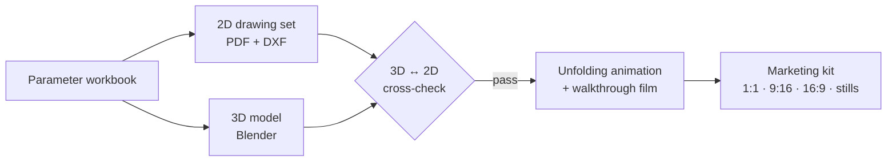

# ATLAS 4.0 — Showcase

**Python-driven parametric design system for expandable houses — one parameter workbook drives BIM-ready data, 2D DXF drawings, 3D models, renders and video.**

  

## Watch the 30-second film

Generated end-to-end from the parameter workbook — no manual modelling or editing.

| Format | Best for | File |
|---|---|---|
| Square 1:1 · 1080 × 1080 | LinkedIn, social feeds | [▶ expandable-house-2br_tour_30s_1x1.mp4](media/videos/expandable-house-2br_tour_30s_1x1.mp4) |
| Vertical 9:16 · 1080 × 1920 | Reels, Shorts, mobile | [▶ expandable-house-2br_tour_30s_9x16.mp4](media/videos/expandable-house-2br_tour_30s_9x16.mp4) |
| Horizontal 16:9 · 1920 × 1080 | YouTube, websites, presentations | [▶ expandable-house-2br_tour_30s_16x9.mp4](media/videos/expandable-house-2br_tour_30s_16x9.mp4) |

Open a file and choose **View raw** (or the download button) to play it.

## How it works

Expandable houses are configured, not drawn from scratch. ATLAS treats every design as **data**: walls, openings, rooms, fixtures, structure and services live in one structured workbook, and every deliverable is generated from it.

- **Change one value → regenerate everything.** Drawings, model, renders and films stay in lock-step.
- **Verified output.** The 3D build is checked against the drawing set, and every frame of the unfolding is checked for clashes.
- **Ready for marketing.** Each validated design produces films in three formats, high-resolution stills and a share poster in minutes.

## Sample design — two-bedroom expandable house

10.10 m × 6.72 m · 67.9 m² · 2 bedrooms · 2 bathrooms

| Exterior | Living / Kitchen |
|---|---|
|  |  |

| Bedroom | Full layout |
|---|---|
|  |  |

| Entry | Share poster |
|---|---|
|  |  |

---

Concept visualization – illustrative, not for construction. Source code and project data are kept private. © 2026 ZHUDUO. All rights reserved.
