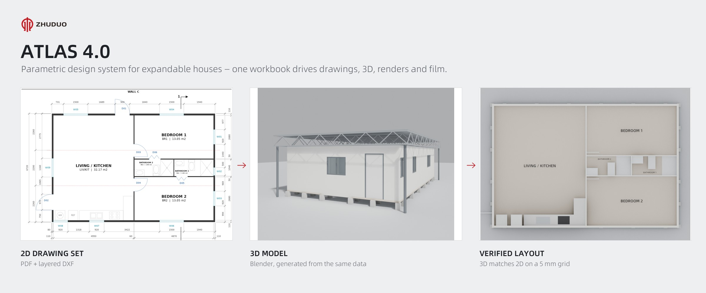
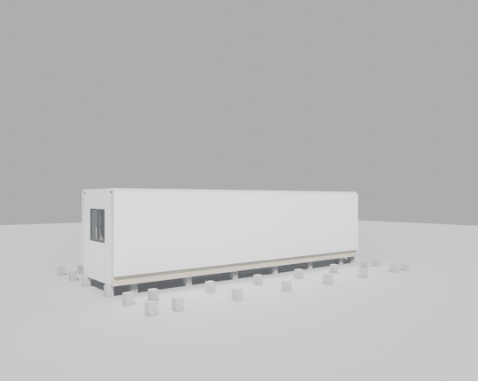
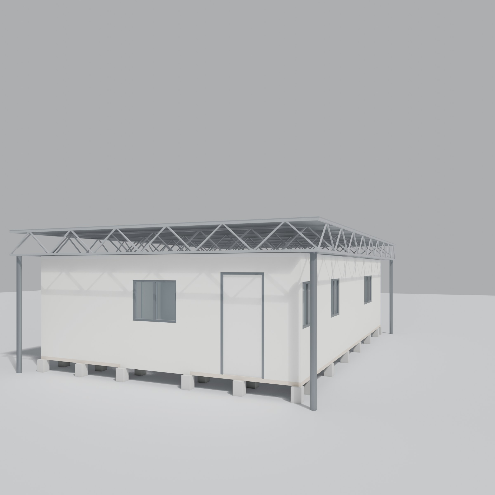
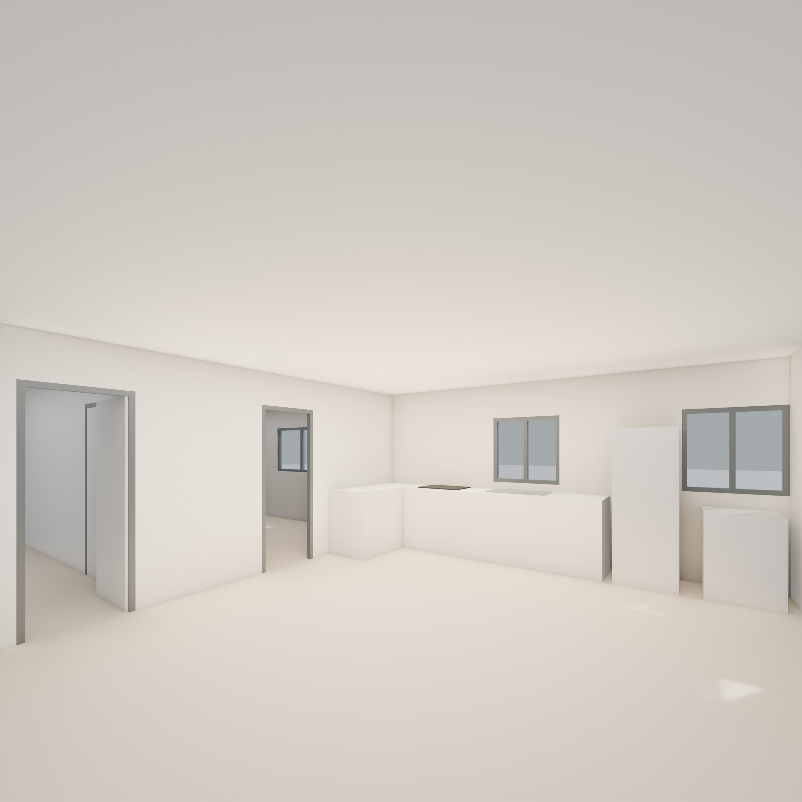
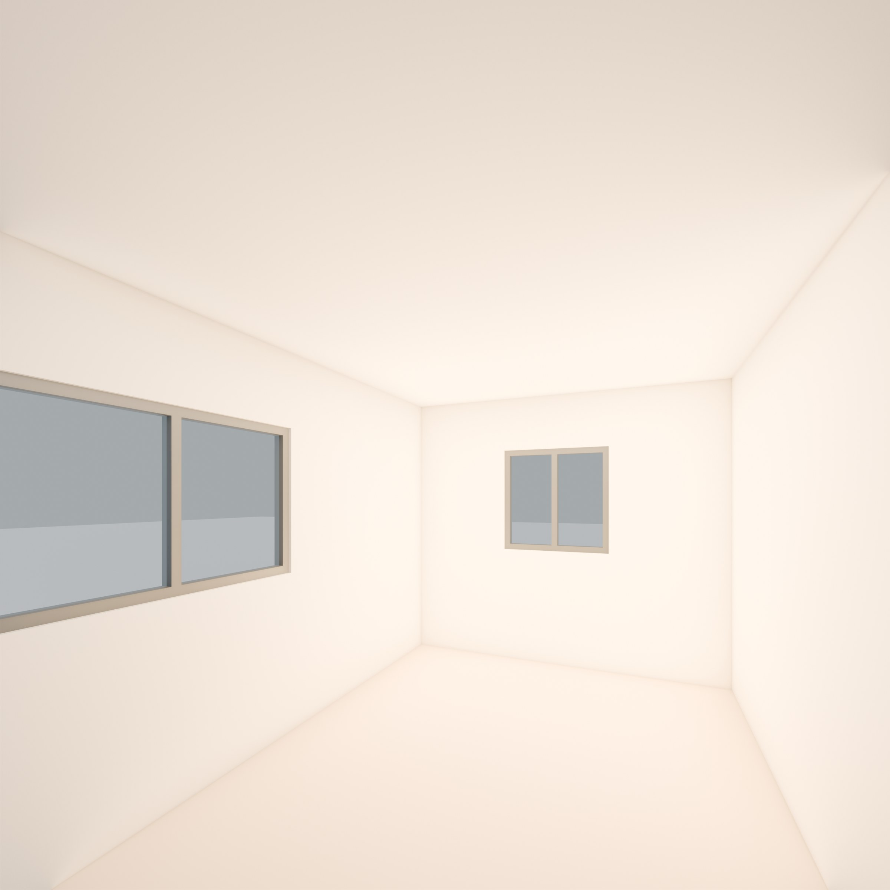
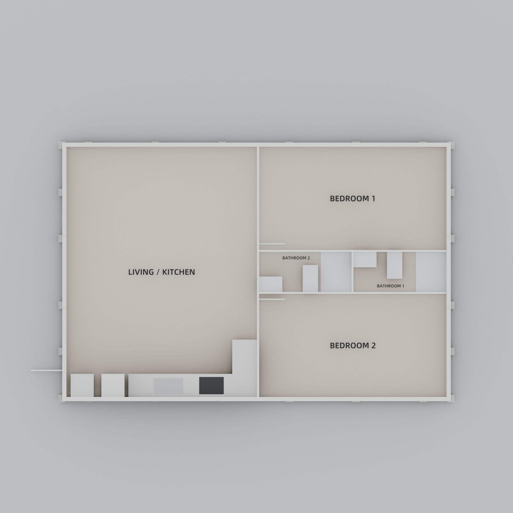
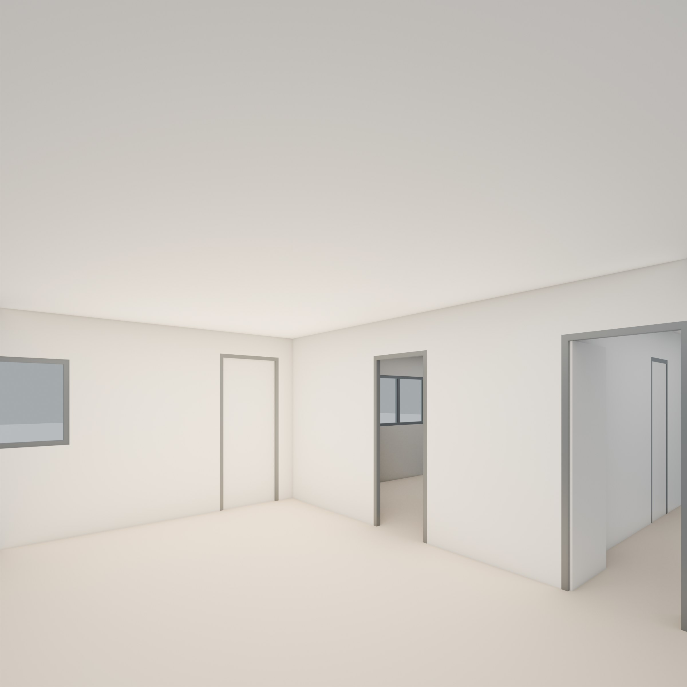
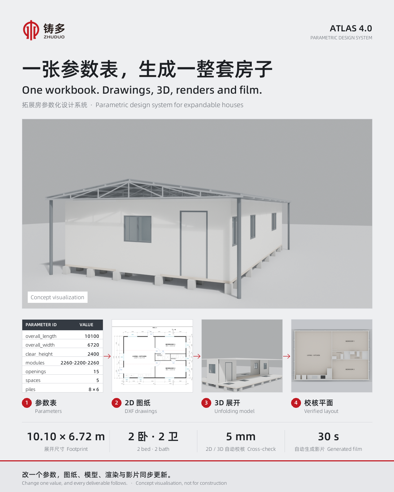
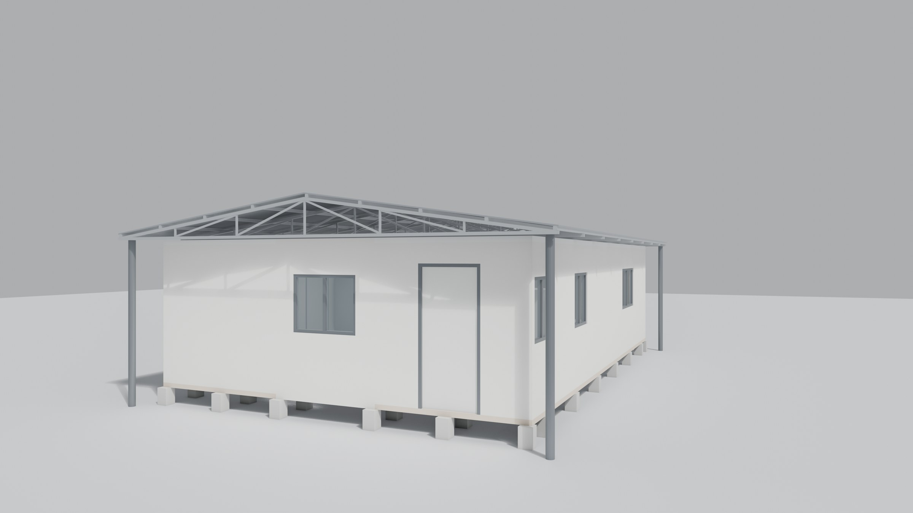

# ATLAS 4.0 — Showcase · 作品展示

**Python-driven parametric design system for expandable houses — one parameter workbook drives BIM-ready data, 2D DXF drawings, 3D models, renders and video.**

**拓展房参数化设计系统：一张参数表，自动生成 BIM 数据、2D DXF 图纸、3D 模型、效果图和视频。**

  

## Watch the 30-second film · 观看 30 秒影片

Generated end-to-end from the parameter workbook — no manual modelling or editing.
全程由参数表自动生成，无需手工建模或剪辑。

| Format 格式 | Best for 适用 | File 文件 |
|---|---|---|
| Square 1:1 方版 · 1080 × 1080 | LinkedIn, social feeds · 领英、朋友圈 | [▶ expandable-house-2br_tour_30s_1x1.mp4](media/videos/expandable-house-2br_tour_30s_1x1.mp4) |
| Vertical 9:16 竖版 · 1080 × 1920 | Reels, Shorts, mobile · 抖音、视频号 | [▶ expandable-house-2br_tour_30s_9x16.mp4](media/videos/expandable-house-2br_tour_30s_9x16.mp4) |
| Horizontal 16:9 横版 · 1920 × 1080 | YouTube, websites, presentations · 官网、演示 | [▶ expandable-house-2br_tour_30s_16x9.mp4](media/videos/expandable-house-2br_tour_30s_16x9.mp4) |

Open a file and choose **View raw** (or the download button) to play it.
点开文件后选择 **View raw**（或下载按钮）即可播放。

All films: H.264 MP4 · 24 fps · ~6–7.5 Mbps (target 8) · 30 s · no audio — ready to upload.
所有影片：H.264 MP4 · 24 fps · 码率约 6–7.5 Mbps（目标 8）· 30 秒 · 无声，可直接上传各平台。

## How it works · 工作原理

Expandable houses are configured, not drawn from scratch. ATLAS treats every design as **data**: walls, openings, rooms, fixtures, structure and services live in one structured workbook, and every deliverable is generated from it.

拓展房是"配置"出来的，不是每次从零画起。ATLAS 把每个设计当作**数据**：墙体、门窗、房间、洁具、结构和设备都写在一张结构化参数表里，所有成果都从这张表自动生成。

- **Change one value → regenerate everything.** Drawings, model, renders and films stay in lock-step.
  **改一个参数，全部同步更新。** 图纸、模型、效果图和影片始终一致。
- **Verified output.** The 3D build is checked against the drawing set, and every frame of the unfolding is checked for clashes.
  **结果经过校核。** 3D 与图纸逐项比对，展开动画逐帧检查构件穿插。
- **Ready for marketing.** Each validated design produces films in three formats, high-resolution stills and a share poster in minutes.
  **直接用于营销。** 每个通过校核的房型，几分钟内生成三种比例的影片、高清图和分享海报。

## Sample design · 示例房型

Two-bedroom expandable house · 10.10 m × 6.72 m · 67.9 m² · 2 bedrooms · 2 bathrooms
两室两卫拓展房 · 10.10 m × 6.72 m · 67.9 m² · 2 卧 · 2 卫

| Exterior 外观 | Living / Kitchen 客厅 / 厨房 |
|---|---|
|  |  |

| Bedroom 卧室 | Full layout 全屋平面 |
|---|---|
|  |  |

| Entry 入口 | Share poster 分享海报 |
|---|---|
|  |  |

---

Concept visualization – illustrative, not for construction. Source code and project data are kept private. © 2026 ZHUDUO. All rights reserved. 
概念示意图，仅供参考，不作施工依据。源代码和项目数据不公开。© 2026 铸多 ZHUDUO 版权所有。
